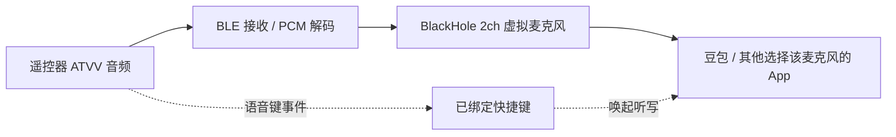

<p align="center">
  
</p>

<h1 align="center">MoteFlow</h1>
<p align="center"><strong>让遥控器，成为你的 Mac 快捷控制台。</strong></p>
<p align="center">Native macOS remote control · Key mapping · Voice input · Automation</p>

<p align="center">
  
  
  
  
</p>

<p align="center">
  <a href="#功能亮点">功能亮点</a> ·
  <a href="#支持的遥控器">设备支持</a> ·
  <a href="#快速开始">快速开始</a> ·
  <a href="#语音输入">语音输入</a> ·
  <a href="#开发与测试">开发与测试</a>
</p>

---

MoteFlow 是一款 **纯原生 Swift / SwiftUI macOS 应用**：将支持的蓝牙遥控器映射成键盘快捷键、应用启动器与可复用动作，并尝试把遥控器语音通过虚拟麦克风交给 Mac 应用。无需 WebView、Electron 或云端控制后台。

> **项目仍在开发中。** 已包含 Google Chromecast Voice Remote 的实机 HID 映射与 ATVV 接收实现；小米遥控器 2 / 2 Pro 目前提供交互示意图、预设和候选 HID 解析，**并不代表完成了实机语音适配**。

## 功能亮点

| 可视化遥控器 | 自由绑定快捷键 |
| :--- | :--- |
| 使用可点击的遥控器图示测试高亮、配置单击与长按。Google 和小米拥有独立布局与配置。 | 支持单键、组合键以及左右 Command / Option / Control / Shift；可以录制或用可视化键盘设置。 |
| **统一动作库** | **ATVV 语音与虚拟麦克风** |
| 将「打开应用、发送快捷键、执行脚本、等待」组合成可复用动作。 | Google 遥控器支持 ATVV 接收及 PCM 解码；可通过 BlackHole 2ch 将声音路由到选定的输入法。 |
| **多设备预设** | **菜单栏轻量运行** |
| 不同型号分别保存动作；支持已知 HID 匹配、高级学习和 JSON 备份。 | 收起主窗口后继续监听，菜单栏可查看状态、暂停动作、重新打开设置。 |


## 支持的遥控器

| 设备 | 图形化按键图 | HID 按键 | BLE / 语音 |
| :-- | :--: | :-- | :-- |
| **Google Chromecast Voice Remote (G9N9N)** | ✅ | 已有真机映射；部分特殊键可能由系统接管 | 已实现 ATVV 接收；到第三方输入法的音频链路仍需真机联测 |
| **小米蓝牙遥控器 2 (RC001)** | ✅ | VID/PID 识别、标准 HID Usage 候选；**待实机确认** | **待验证** |
| **小米蓝牙遥控器 2 Pro (RC003)** | ✅ | 独立预设与候选码；**待实机确认** | **待验证** |
| **通用遥控器** | ✅ | 提供布局及高级学习入口；不自动接管未知设备 | 依具体硬件协议 |

**注意：** 蓝牙连接成功不代表 macOS 已注册 HID；预设识别也不等于该固件所有按键都可用。未知键需要真实日志与设备适配。

## 快速开始

### 系统要求

- macOS **14 Sonoma 或更新版本**
- Xcode（可编译 SwiftUI macOS 工程；建议使用适配本机 macOS 的版本）
- 支持的蓝牙遥控器，或先在图形预览中体验绑定流程
- 需要实体 HID 监听时，授权 **系统设置 → 隐私与安全性 → 输入监控**；执行键盘快捷动作可能还需要**辅助功能**权限

### 从源码运行

```bash
git clone https://github.com/lengsukq/MoteFlow.git
cd MoteFlow
open GoogleRemote.xcodeproj
```

打开 Xcode 后选择 **GoogleRemote** Scheme 构建运行（旧工程名为兼容历史配置而保留；最终 App 显示为 **MoteFlow**）。

命令行仅编译检查：

```bash
xcodebuild -project GoogleRemote.xcodeproj \
  -scheme GoogleRemote -configuration Debug CODE_SIGNING_ALLOWED=NO build
```

使用你的 Apple Developer Team ID 签名并安装到 `~/Applications`：

```bash
MOTEFLOW_DEVELOPMENT_TEAM=YOUR_TEAM_ID \
  bash scripts/install_signed_mac.command
```

> 默认只提供源代码，不保证有预编译的二进制安装包。签名、蓝牙及输入监控授权与用户本机环境有关。

### 第一次使用

1. 在 macOS 蓝牙设置中配对遥控器，打开 MoteFlow 的「遥控器 → 连接设备」确认状态。
2. 从内置 **Google / 小米 2 / 小米 2 Pro / 通用** 图形预设中选择对应型号。匹配到可信 HID 设备时会自动切换。
3. 进入「按键测试」按实体键核对高亮；未匹配的键在「诊断 / 高级学习」中采集真实报告。
4. 在「按键配置」给**单击**或**长按**绑定快捷键、应用或动作库模板；需要时再打开实体按键执行开关。
5. 在「设置」启用菜单栏轻量模式，可将窗口收起，不必保持控制台始终显示。

## 语音输入

MoteFlow 的语音功能分为两个独立环节：



**仅触发听写快捷键不会传输遥控器声音。** 如需转发语音，可在「语音 → 麦克风设备」安装或检测 [BlackHole 2ch](https://github.com/ExistentialAudio/BlackHole)，启用实时音频路由，并让目标输入法选择 BlackHole 或跟随系统默认输入。MoteFlow 可选择性地在语音会话期间临时切换系统默认输入，结束后尝试恢复。

音频兼容性、延迟和第三方输入法的实际转写效果依设备及系统配置而异，仍需实机验证。

## 开发与测试

| 组件 | 技术 |
| :-- | :-- |
| 界面和菜单栏 | SwiftUI、AppKit |
| 蓝牙及 ATVV | CoreBluetooth、ADPCM 解码 |
| 按键采样 | IOKit / IOHIDManager |
| 快捷键与动作 | CoreGraphics、原生进程 |
| 音频路由 | CoreAudio AudioQueue、BlackHole |
| 自动测试 | Swift Package Manager / XCTest |

```bash
swift test
```

当前代码包含协议处理、按键映射、设备预设、动作库和 PCM 转换的测试。**单元测试通过不等同于 HID 独占、音频设备切换或实体遥控器端到端验收通过。**

### 项目结构

```text
GoogleRemote/
  Assets.xcassets/       AppIcon、菜单栏图标与品牌资源
  Sources/              SwiftUI、蓝牙、HID、音频及动作执行
GoogleRemote.xcodeproj/ Xcode macOS App 工程
Tests/                  Swift Package Manager 测试
scripts/                图标生成与签名安装脚本
docs/                   公开的设备预设、HID 学习及品牌文档
Package.swift           可独立测试的协议/映射核心
```

更多细节：
[遥控器型号与适配边界](docs/REMOTE-PROFILES.md) ·
[HID 学习与映射导入](docs/HID-MAPPING-PROFILES.md) ·
[品牌与图标](docs/BRANDING.md)

## 安全与隐私

- 仅对识别并允许的 HID 遥控器接口尝试独占，避免误接管 Mac 键盘与鼠标。
- 本机学习结果、按键动作配置默认存放在用户本机；日志和 WAV 由用户主动导出。
- 录音文件转写请求使用支持的 macOS 本机识别模式，不自动回退在线识别。
- 脚本执行、系统权限、BlackHole 安装或卸载需要用户主动配置/确认。

## 路线图

- [x] 原生 macOS 控制台、图形化快捷键和动作库
- [x] Google G9N9N HID 默认映射和 ATVV 接收代码
- [x] 小米 RC001 / RC003 图示和设备预设隔离
- [x] BlackHole 设备管理与 PCM 路由代码
- [x] 菜单栏轻量模式
- [ ] 小米遥控器 2 / 2 Pro 实体 HID 与语音通道验收
- [ ] BlackHole → 豆包的端到端转写验收
- [ ] 休眠唤醒、蓝牙重连和长时间轻量模式稳定性验收
- [ ] 完整的安装发布、设备兼容性测试矩阵

---

<p align="center">
  <strong>MoteFlow</strong> — One remote. More possibilities.
</p>

<p align="center">
  本项目不是 Google、小米、豆包或 BlackHole 官方产品，与上述品牌无隶属关系。
</p>

**许可说明：** 当前代码库未附开源许可证。公开可见不等于自动授予复制、修改或商业使用权限；若后续计划开放使用，请由项目所有者明确选择并添加许可证。
